<!--
  Cards animados em SVG, desenhados por scripts/render_cards.py
  e atualizados todo dia por .github/workflows/update-profile-art.yml.
  O texto mora em profile.json. O retrato pontilhado mora em data/portrait.json.
  Não deixe linhas em branco neste bloco: o espaçamento já está dentro dos SVGs.
-->

 
 
 
 

<a href="https://github.com/GeovaneVrs">GitHub</a> &nbsp;/&nbsp; <a href="https://www.linkedin.com/in/geovane-valerio-213175297/">LinkedIn</a>

